# Volume-Shock Reversal

**A-share daily factor research · EMA40 · gross performance · IC / Rank IC · robustness and incremental-information diagnostics**

[中文说明](README.zh-CN.md) · [Research notebook](notebooks/volume_shock_reversal.ipynb) · [Methods](reports/methodology.md) · [Research history](reports/research_history.md) · [Data interface](data/README.md)

This project studies whether short-term price moves accompanied by abnormal volume contain subsequent reversal information. It publishes a portable engine, derived research aggregates, and 17 English figures. **Gross results are the primary signal-strength view; 10 bp is retained as an implementation companion.**

The proposed explanation is transient order pressure or overreaction. It is a hypothesis, not a directly identified investor-sentiment mechanism.

## Factor

$$R^{(5)}_{i,t}=\prod_{k=0}^{4}(1+r_{i,t-k})-1$$
$$AV_{i,t}=\frac{V_{i,t}}{\frac{1}{5}\sum_{k=1}^{5}V_{i,t-k}}-1$$
$$F_{i,t}=\mathrm{EMA}_{40}\left[-R^{(5)}_{i,t}\max(AV_{i,t},0)\right]$$

The volume reference excludes today. Processing is average cross-sectional rank -> one joint industry / log-float-cap OLS -> population-z residual. Positive/negative signals target long +100% / short -100% of NAV, rebalanced daily at the **next close**. Gross target exposure is 200%; reported returns are per NAV. All source data end 2026-10-20.

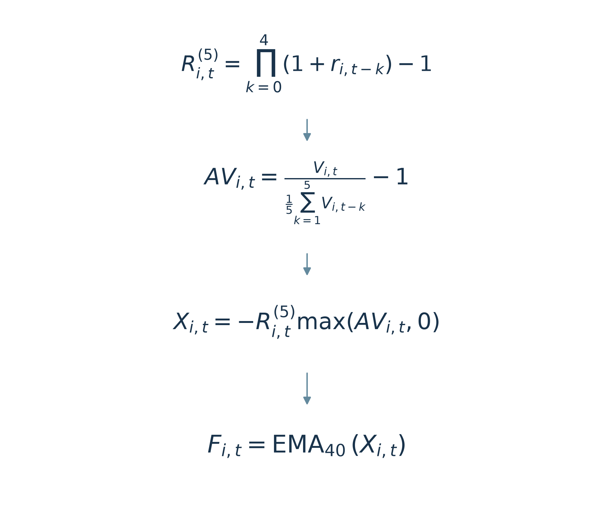

## Gross performance — primary view

| Period | Gross CAGR (%) | Sharpe | MDD (%) | One-way TO (%) |
|---|---|---|---|---|
| 2012–2024 | 28.2636 | 3.3117 | 10.2688 | 11.6574 |
| 2025–2026-10-20 | 24.9782 | 2.1618 | 13.6427 | 10.1043 |

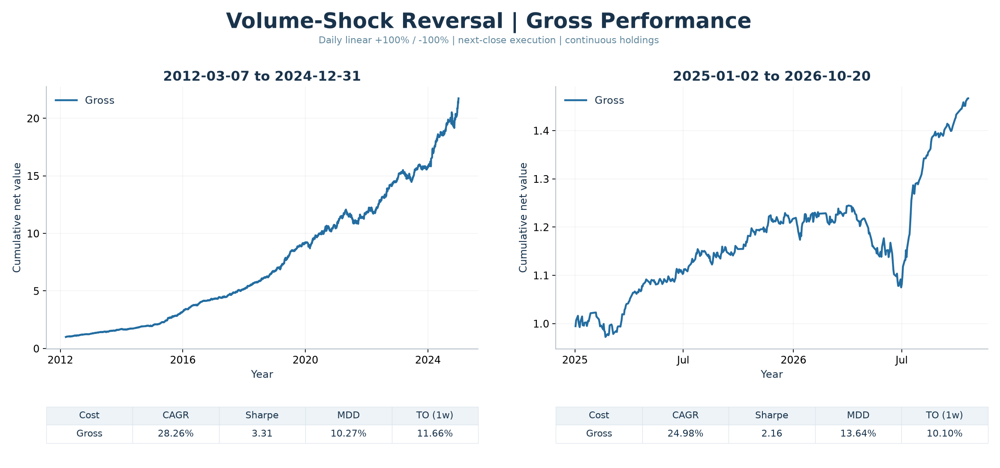

The nominal research window begins 2010, but historical universe / warmup constraints move actual performance to 2012. The later window is **already inspected historical data**, not untouched OOS. Main positions continue across 2025; period charts rebase the same ledger.

## IC and Rank IC — predictive quality

IC is Pearson and Rank IC is Spearman between the **final processed score** and future returns after next-close entry. 1/5/21-session horizons use rolling daily labels; they are not three separate trading schedules. Overlapping labels use HAC uncertainty estimates. ICIR below is **unannualized mean/std**.

| Period | Sessions | Metric | Mean | ICIR (raw) | Positive fraction | HAC t |
|---|---|---|---|---|---|---|
| research | 1 | ic | 0.0179 | 0.2202 | 0.5948 | 11.8915 |
| research | 1 | rank_ic | 0.0425 | 0.4798 | 0.6905 | 26.0546 |
| research | 5 | ic | 0.0355 | 0.4681 | 0.6814 | 12.2124 |
| research | 5 | rank_ic | 0.0652 | 0.7917 | 0.7902 | 21.4617 |
| research | 21 | ic | 0.0499 | 0.6934 | 0.7683 | 10.6192 |
| research | 21 | rank_ic | 0.0834 | 1.0729 | 0.8644 | 16.6966 |
| later | 1 | ic | 0.0125 | 0.1352 | 0.5916 | 2.1024 |
| later | 1 | rank_ic | 0.0527 | 0.4943 | 0.7193 | 8.7380 |
| later | 5 | ic | 0.0266 | 0.2880 | 0.6089 | 2.2773 |
| later | 5 | rank_ic | 0.0752 | 0.7330 | 0.7752 | 6.0330 |
| later | 21 | ic | 0.0351 | 0.3353 | 0.6010 | 1.8266 |
| later | 21 | rank_ic | 0.0984 | 0.9070 | 0.8175 | 5.0588 |

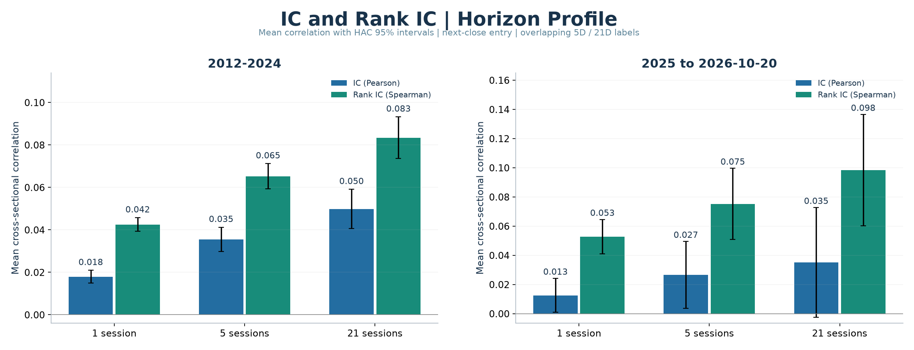
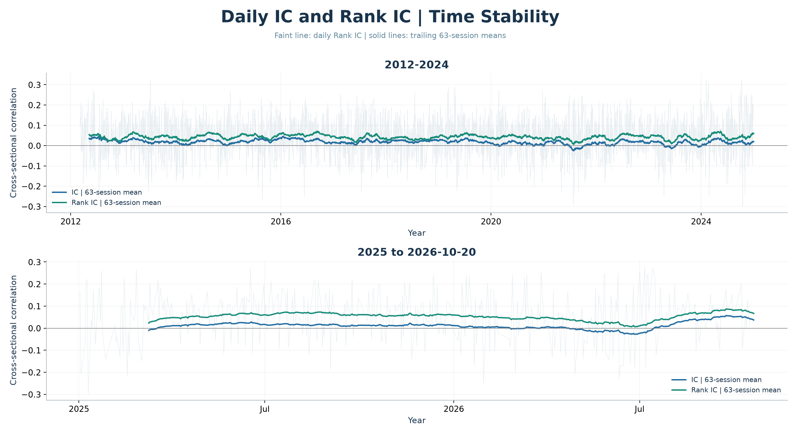
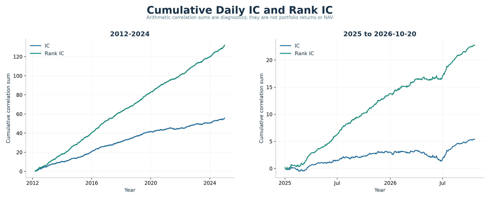

Cumulative IC is an arithmetic sum of correlations, **not NAV**. The daily-label sample count can differ from portfolio sessions because entry/exit quotes must be observed and labels cannot cross interval endpoints.

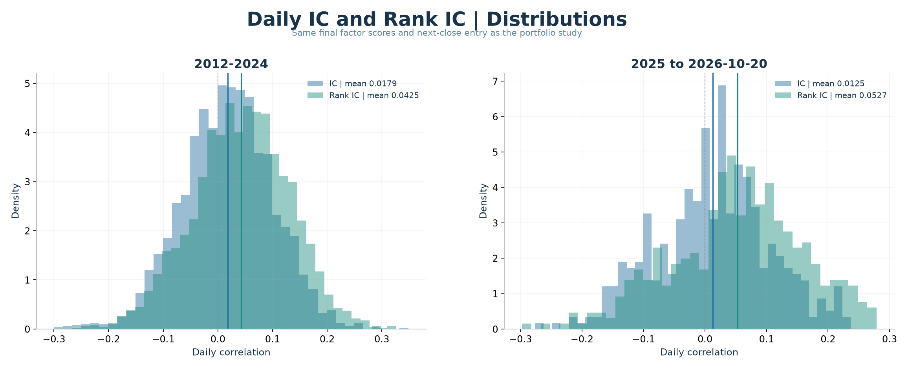
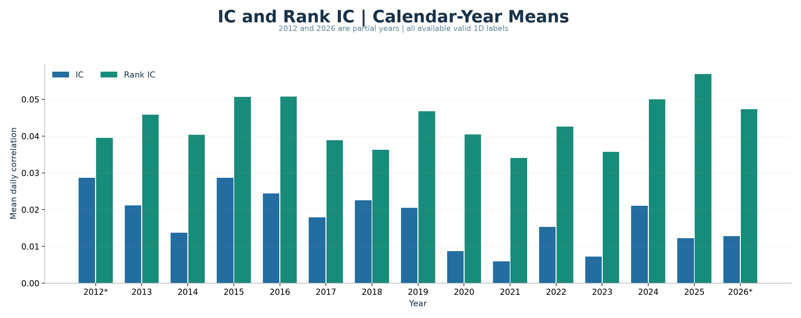

## Cross-sectional ordering — deciles

G1/G10 are low/high final scores. Each group is an independently simulated 100%-long equal-weight portfolio. This is a diagnostic separate from the primary signal-weighted long-short book. Deciles retain the original publication's per-period cash initialization; their later interval starts 2025-01-03.

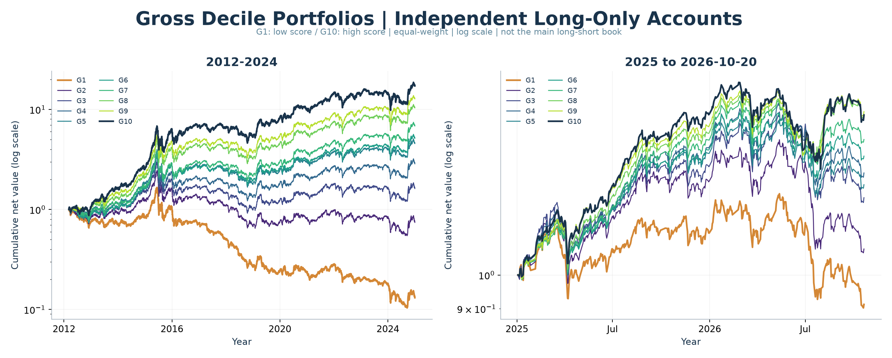
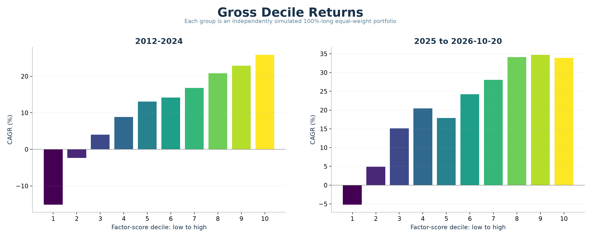

## Parameter and historical stability

The dense fixed grid is return window 3–7 × volume reference 3–7 × EMA 30/35/40/45/50 =125 configurations. The centre 5/5/40 stays fixed. All 125 had positive 10 bp returns in both historical windows. The parameter audit uses its own common frozen pool; do not mix its values with other studies as if membership never changed.

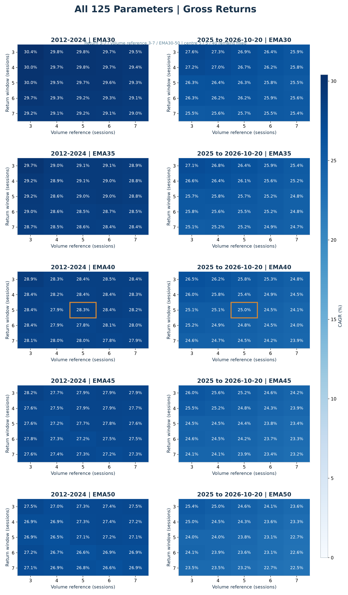
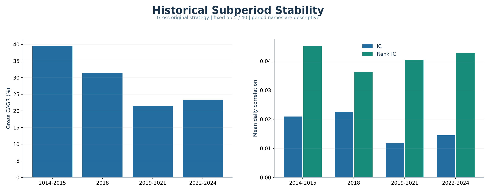

## Incremental information — two matched controls

The focused tests use (1) pure 5-day reversal with EMA40 and (2) abnormal turnover with EMA40. Abnormal turnover is today's volume / float shares divided by its prior 20-session mean minus 1. Both are ranked in the same pool. Each residual starts from the raw target rank and **one joint industry / float-cap / selected-control OLS**. No RV control, second neutralization, or residual reranking is used here.

Jointly controlled **gross** performance:

| Period | Gross CAGR (%) | Sharpe | MDD (%) | One-way TO (%) |
|---|---|---|---|---|
| research | 13.9133 | 2.3195 | 6.6380 | 15.9240 |
| later | 19.7187 | 2.3571 | 5.1561 | 13.9885 |

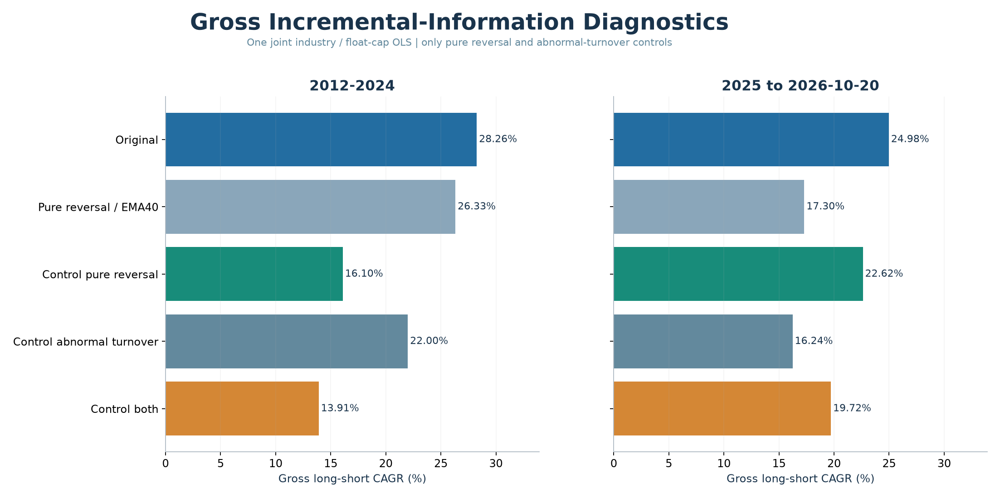
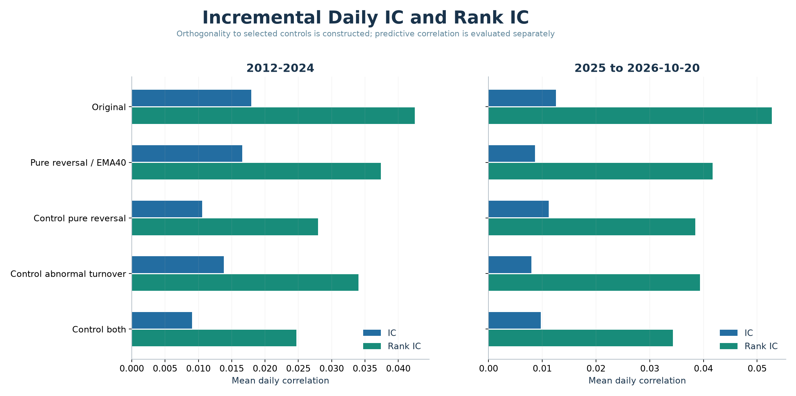

At 10 bp, the joint residual CAGR is 5.10% / 11.44%, with daily Rank IC 0.0247 / 0.0343. Rank IC is significant in both periods. The later net PNL mean has HAC two-sided p≈0.055, so its net-return significance is weaker. Original versus pure-reversal PNL differences also do not reach a conventional 5% two-sided threshold. Positive residual performance does not prove sentiment causality or universal independence from known factors.

## Trading intensity and costs

EMA40 followed a historical 20/40/60 comparison, rather than a preregistered theoretical optimum. It lowered one-way turnover about 30%–32% versus EMA20 on the matched comparison pool.

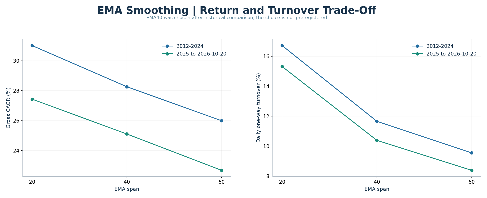
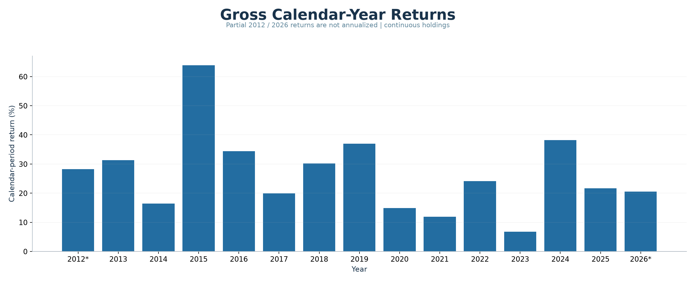
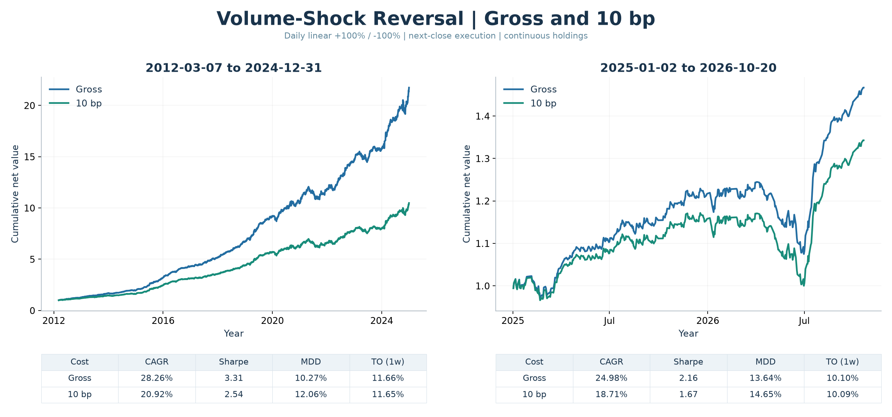

Gross excludes transaction, impact, financing and borrow costs.10 bp is charged per actual executed amount. Nontradable holdings freeze and failed target budgets are not redistributed. These research execution assumptions are not a full limit-order, capacity or stock-borrow model.

<details><summary>10bp parameter-audit companion</summary>

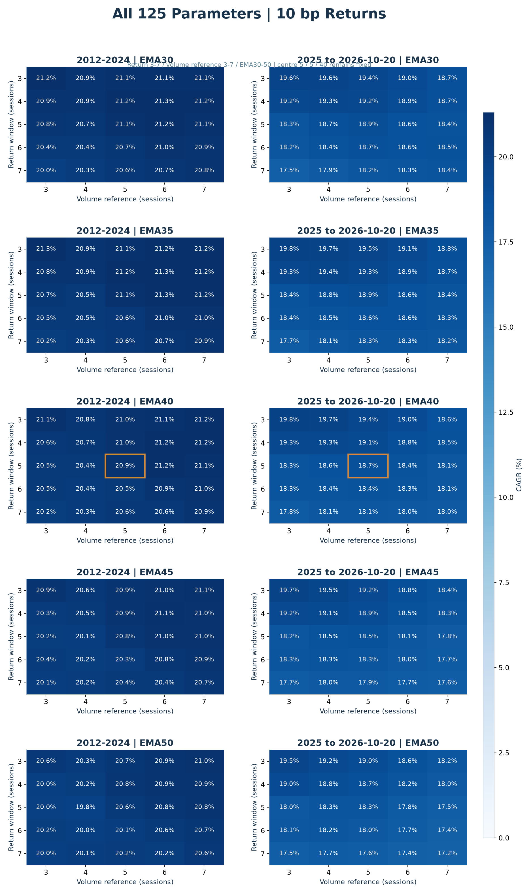
</details>

## Reproduce

Python 3.11+ is recommended. Run from the repository root:

```bash
python -m pip install -r requirements.txt
python -m pip install -e . --no-deps
python scripts/render_report.py
python -m unittest discover -s tests -v
```

The notebook reads released aggregates and embeds saved outputs. Every major study has a separate cell. To exercise the engine with synthetic data:

```bash
python examples/make_demo.py
python -m volume_shock_reversal --input data/local/synthetic.npz --output results/local_run
```

Synthetic output is an engine demonstration, **not the source of the empirical results**. A real-data rerun needs provider-compatible historical panels and the same universe; see[data/README.md](data/README.md). Stock-level market data and the historical eligibility mask are not redistributed.

## Selection disclosure and limits

- The candidate emerged from 246 economic-hypothesis candidates; the initial version used EMA20 and EMA40 was chosen after comparison. Both historical windows have been inspected.
- Local 27/125-parameter plateaus and historical walk-forward tests do not eliminate all search overfitting. Local CSCV ranking diagnostics are not future-loss probabilities or a full-project correction.
- Earlier local CNE5-style tests found material known-style / signal overlap. The latest focused control results do not revoke that evidence. These are not official/full MSCI Barra exposures.
- No independent sentiment dataset or causal identification is supplied. Price/volume proxies cannot identify optimism versus panic.
- Source history revisions/PIT, historical industry availability, ST/delisting settlement, price limits, borrow and capacity remain limitations.
- Empirical tables are snapshots through 2026-10-20; no future or live performance is claimed. A forward parameter-freeze protocol was recorded; no completed forward validation is claimed.

## References

- [Barber & Odean — attention and investor buying](https://doi.org/10.1093/rfs/hhm079)
- [Baker & Stein — market liquidity as a sentiment indicator](https://doi.org/10.1016/j.finmar.2003.11.005)
- [Bailey et al. — probability of backtest overfitting](https://www.davidhbailey.com/dhbpapers/backtest-prob.pdf)

This repository documents an exploratory research result. It does not claim a novel first-discovered anomaly, verified causal sentiment mechanism, or deployable trading strategy.
